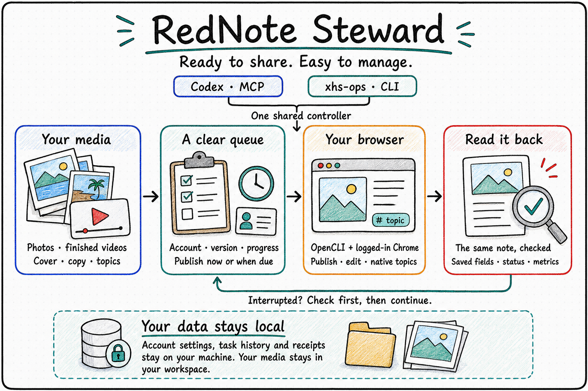

<p align="center">
  
</p>

<p align="center">
  <a href="./README.md"><strong>English</strong></a> | <a href="./README.zh-CN.md">中文</a>
</p>

<h1 align="center">RedNote Steward</h1>

<p align="center"><strong>Publish, organize, and maintain your Xiaohongshu account from one local workspace.</strong></p>
<p align="center">Photos · Finished videos · Existing posts · Publication history</p>

RedNote Steward brings ready-to-share media, account settings, publication tasks, and platform results into one workflow. Use it through Codex, a standard MCP client, or the `xhs-ops` command line. It reuses a logged-in Chrome session through OpenCLI and keeps the progress of each task on your machine.

A travel photo collection, a series of finished educational videos, and an update to an older post all need the same practical answers: which version is ready, which account will receive it, what has already been submitted, and where to continue after an interruption. Steward keeps those answers with the task, so they remain available in the next conversation or terminal session.

<p align="center">
  
</p>

## What You Can Ask It To Do

> “Publish these prepared posts to my account in order, using the included covers and copy. Keep a record of each result.”

> “Show what is queued, what has been published, and which interrupted tasks need checking.”

> “Review this week's travel photos and posts. Keep my voice, improve the parts that benefit from editing, and preserve the scene in any photo adjustments.”

> “Match these revised videos to their earlier posts before we decide which versions to publish.”

The bundled Skill helps an assistant follow these workflows. Your account preferences, content decisions, and existing authorization remain part of your own workspace.

## Core Capabilities

| Work | What Steward provides |
| --- | --- |
| Prepare a release | Image or video packages with copy, native topic names, optional cover, and file fingerprints |
| Manage accounts | Stable account ID and browser profile bindings, with identity checks before writes |
| Publish and edit | A local queue, explicit authorization records, due times, and one active write per account |
| Continue after interruption | Saved attempts, platform note IDs, readback, and reconciliation before another attempt |
| Maintain existing posts | Inventory, supported text/topic/image edits, metrics, and review candidates |
| Use another client | CLI and standard MCP Server over the same controller and task database |

Account preferences and operational records live outside the installed code. Media stays in the workspace you choose. Installation adds no recurring inspection or background publishing schedule.

## Install on macOS

With Node.js 24+ available, run:

```bash
curl -fsSL https://raw.githubusercontent.com/gaofeng21cn/rednote-steward/main/install.sh | bash
```

The installer installs the application, a pinned OpenCLI version, bundled adapters, and the generic Skill. When Codex is available, it also registers the MCP Server. It prepares the Browser Bridge extension; follow the printed instructions to enable it in Chrome and sign in to Xiaohongshu. Existing connected sessions can be reused.

Add the command directory to the current shell PATH, then discover the browser profile and account:

```bash
export PATH="$HOME/.local/bin:$PATH"
xhs-ops opencli profile list
xhs-ops account probe --profile YOUR_PROFILE
xhs-ops account add personal --user-id YOUR_USER_ID --profile YOUR_PROFILE
xhs-ops doctor --account personal
```

Use the ID returned by the probe. Give each account its own profile binding. The [installation guide](docs/installation.md) covers a fresh machine, MCP clients, upgrades, and removal.

## Publish a Prepared Package

Create a `post.json` beside your media:

```json
{
  "schemaVersion": 1,
  "platform": "xiaohongshu",
  "account": "personal",
  "kind": "publish",
  "title": "A moment by the sea",
  "body": "Your own caption goes here.",
  "topics": [],
  "images": ["photos/01.jpg", "photos/02.jpg"]
}
```

Then inspect it and add it to the queue:

```bash
xhs-ops inspect ./post.json
xhs-ops ingest ./post.json
xhs-ops approve TASK_ID --authorization "Publish this prepared package" --now
xhs-ops run TASK_ID
xhs-ops show TASK_ID
```

An assistant can record an existing authorization for the requested batch; the `approve` command does not require another conversational approval. For video, use `video` and optional `cover` fields in place of `images`. Native topic names belong in `topics`; the adapter selects platform candidates during publishing.

See [publishing and recovery](docs/publishing.md) for video packages, edits, scheduling, and interrupted tasks. [Synthetic examples](examples/) contain no account data or real posts.

## Use With an MCP Client

The standard STDIO server is available as `rednote-steward-mcp`:

```json
{
  "mcpServers": {
    "rednote-steward": {
      "command": "rednote-steward-mcp"
    }
  }
}
```

Use the installed executable's absolute path when your client does not inherit the shell PATH. CLI and MCP share account settings and task state. Long publishing calls return a task ID for subsequent progress queries.

## Current Scope

The first release targets macOS and logged-in Chrome through OpenCLI. Image publishing, existing-post maintenance, account reads, and inventory build on the original local workflow. Video and custom-cover support are included in the adapter; automated tests exercise their control flow, while live video publication remains a separate acceptance step. Platform changes may require adapter updates.

The release provides a CLI, a standard MCP Server, and an assistant Skill. A graphical MCP App is a possible follow-up. Content generation and automatic photo enhancement are performed by the tools you choose; Steward manages their prepared outputs and publication records.

## Documentation and Development

- [Installation](docs/installation.md) — new users, browser connection, MCP, upgrades, and removal.
- [Publishing and recovery](docs/publishing.md) — content packages, edits, task states, and reconciliation.
- [Architecture](docs/architecture.md) — the shared controller, account isolation, and private data layout.
- [Assistant Skill](skills/rednote-steward/SKILL.md) — publishing and account-maintenance guidance.

```bash
npm ci
npm test
npm run check:package
```

## License

[Apache License 2.0](LICENSE). OpenCLI and other reused components are credited in [NOTICE](NOTICE).
