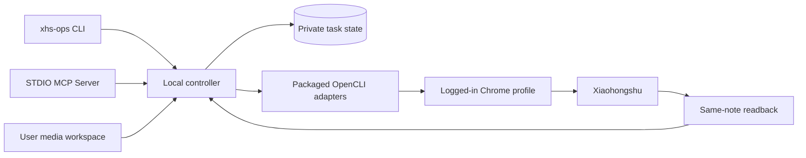

# Architecture

RedNote Steward has one local controller behind its CLI and MCP Server. Both use the same account bindings, task database, execution rules, and platform adapters.

## The main objects

| Object | Purpose |
| --- | --- |
| Account binding | Maps a local alias to a stable platform user ID and browser profile |
| Content package | Defines the intended title, body, topics, media, and existing-note relationship |
| Task | Stores the frozen package, authorization, due time, attempts, and current state |
| Batch | Groups a bounded set of tasks for authorization, execution and per-item results |
| Platform note | Identifies the published or edited post by its platform ID |
| Catalog and series | Organizes observed platform notes by account, series, episode, source and maintenance decision |
| Media lineage | Links originals, derivatives and the bytes selected for upload |
| Metric observation | Stores an account/note measurement at its capture time |
| Readback and receipt | Records the adapter result and which platform fields were checked |

The source package and prepared media stay in the user's workspace. Ingestion hashes the selected media and stores its paths with the task. Execution checks that the files still match before using them. A revised package is a distinct version; it does not silently replace a queued task's input.

## Execution and recovery

Task claims are transactional in the private SQLite database. Automatic selection chooses an eligible due task, keeping each account's unresolved outcomes isolated from unrelated accounts. A local registry assigns one state owner to a stable account ID or browser profile across state roots on the same machine. Account identity is checked in the selected browser profile before a write.

A successful browser submission and a matching platform readback are recorded separately. When the outcome is uncertain, the task preserves that uncertainty and the account remains held for reconciliation. Recovery first reads the current platform state, links the matching note when available, and records the evidence. Retrying is a later action based on the resolved result and the applicable user authorization.

MCP execution launches a separate worker and returns a task ID. Clients query that task for progress and completion. This keeps a long upload independent of a single tool response window.

Attempts retain observed phases and structured errors. A worker launch, a claimed task and a platform submission are separate evidence. Adapter phase events explain upload/processing/preparation when observed; a phase checkpoint does not guarantee the browser or platform retained the composer. Manual publication uses the original task's handoff and a read-only link to the exact platform note. Receipt, metric or later observation failures are repaired without submitting the publication again.

Pause controls prevent future claims, while cancellation is limited to unstarted tasks. A batch is an execution group, independent from a series of related content. Each item retains its own fingerprint, authorization and result.

## Data and installation

Public source and installation packages contain code, adapters, a generic Skill, documentation, and synthetic fixtures. Personal account settings, platform note IDs, content, metrics, receipts, and browser sessions belong to user storage.

The default private data root is `~/.local/share/rednote-steward`, selected with `XHS_OPS_HOME`. Installed application releases occupy its separate `app/` subtree; private state is kept outside those release directories. A user can choose a completely separate installation root with `XHS_OPS_INSTALL_ROOT`. Media is referenced at its original workspace path.

OpenCLI is bundled at a tested version. The packaged adapter runner loads Steward's commands without replacing an independently installed OpenCLI or modifying the user's `~/.opencli` adapter directory. Chrome retains its own login state.

The release manifest describes package/source identity, dependency versions and capability evidence. Installation receipts and doctor use that identity to distinguish source, installed release, browser connection, account login and qualified media operations. Unmeasured capabilities remain unknown. Public diagnostics redact account identifiers, cookies, source media and private paths.

Release packaging starts from committed source and produces a versioned archive, manifest and checksums. Installation validates the archive checksum and the manifest's public-content digest before selecting the new version. `--source` development installs record their actual source revision and dirty state. This identity stays separate from the private account data and browser qualification results.

Catalog synchronization is a local observation and organization operation. It preserves series and maintenance decisions while updating platform fields, and creates no publication tasks. Metric observations append account/note/capture-time rows; the latest metrics view remains a convenience projection. Optional media lineage records source and derivative hashes without processing the files.

Backups use a consistent SQLite snapshot with configuration and selected receipt files. Restore previews validate checksums, schema and path mappings before writing an empty destination. Restored active attempts become unresolved and process IDs are cleared; restoring state does not launch a task.

## Adapter responsibility

OpenCLI performs browser operations through Browser Bridge. The controller owns task identity, package version, account serialization, authorization records, and recovery. Adapters own the actual page interaction and expose what the platform returned.

One-shot Xiaohongshu adapters close their exact owned tab on success and error through Browser Bridge's `close-owned-tab` action (1.0.26+). Creator editors register a departure warning, so a generic lease release that navigates the tab to `about:blank` can leave a confirmation prompt and an accumulating tab. Cleanup applies to the current adapter-owned session. `prepare-only`, explicit `--keep-tab true` and persistent sessions retain their page for handoff. Doctor reports version compatibility separately from live cleanup qualification; cleanup diagnostics preserve the business result.

The local browser workflow focuses on macOS and one backend. Optional backends can later implement the same task semantics after their media, cover, native-topic, editing, and readback behavior has been verified. The OPL shared MCP App reads the existing queue through `src/app-contribution.mjs`; it owns no task state. Task, content and media views use the existing Package descriptor and contribution ABI. `review` opens SQLite read-only and never initializes a database, starts a worker, or reads the platform. Review data includes the frozen content fingerprint, the stored task revision, source drift, same-note field verification and separate publication evidence. Media drift disables the artifact link rather than presenting changed bytes as the frozen asset.

## Verification

The repository tests package validation, stable fingerprints, account binding, concurrent task handling, interruption behavior, adapter control flow, installer isolation, and the MCP protocol. Live account reads provide separate evidence for browser connection and identity. Actual publishing, platform review, and audience outcomes each require their own observation.

## Exact review handoff

`xhs-ops review [TASK_ID]` and MCP `task_review` return the same owner projection as the shared contribution. Select `rednote.steward.review` or `rednote.steward.media` with `task_id`, and optionally the returned `fingerprint` and `revision`, through `open_opl_apps`. Missing identity opens an input form; a mismatched identity or revision fails. The task list supports the same `task_id` filter and an optional account alias.

A human can inspect the content and ask the Agent to continue under the existing publication authorization. `approve` / `task_authorize` accept the reviewed `fingerprint` and `revision` so a changed task cannot silently inherit a stale handoff. Execution still rechecks the frozen package and account in the existing Controller. The shared views expose no publishing actions. Reopening unresolved attempts only observes the original task; the existing `reconcile` command resolves its outcome before a retry.

The `opl-package.json` contribution is development-only, with no publication reference. Native plugin metadata and the npm package include the same descriptor, adapter and owner source; this is source packaging, not an installed-host or live-account acceptance claim. Node 24 or newer is required. `npm run lock:package` updates the standard Package content lock after source edits, and `npm run check:package` verifies the lock and packaged files.
